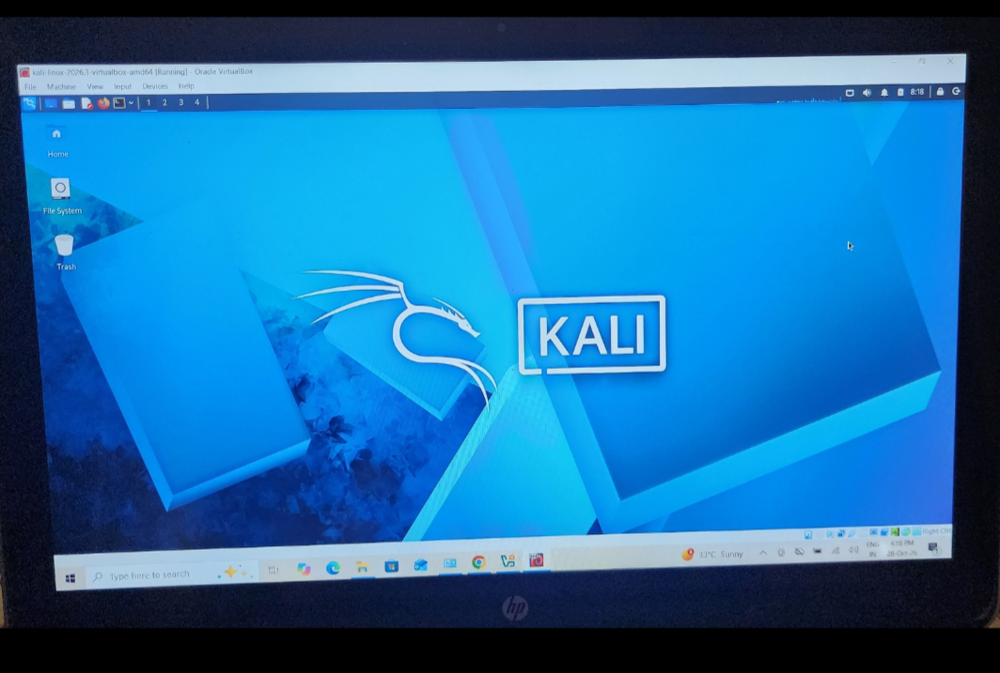

# 🔐 Cybersecurity Lab Environment Setup

**Building an isolated virtual lab for penetration testing and ethical hacking practice**
This repository documents the step-by-step engineering, deployment, and configuration of my isolated virtual cybersecurity laboratory environment used for penetration testing, vulnerability assessment, and malware analysis simulations.
## 📌 Project Overview
This project guides you through setting up an isolated virtual cybersecurity and penetration-testing lab using VirtualBox and Kali Linux on a private NAT Network. For full configuration details, system specifications, troubleshooting steps, and documentation templates, please refer to the sample GitHub repository.

## 🎯 Objectives & Architecture
- Install VirtualBox and import Kali Linux.
- Configure a private NAT Network (`10.0.0.0/24`) for secure internal communication and outbound internet access.
- Assign static IP configurations and troubleshoot network connectivity issues.
- Save a clean VM snapshot for easy recovery.

  ## 🖥️ Active Lab Desktop (My Running Environment)

Below is the verified screenshot of my live, successfully deployed virtual machine environment:

## 🪜 Summary of Steps
1. **Prerequisites:** Install 7-Zip and VirtualBox.
2. **Network Creation:** Set up a custom NAT Network in VirtualBox.
3. **VM Import & Config:** Import Kali Linux and map a shared folder.
4. **Static IP Assignment:** Configure manual network parameters inside Kali.
5. **Verification & Troubleshooting:** Test connectivity and resolve potential DAD timeout issues using `nmcli`.
6. **Snapshots:** Capture a baseline clean snapshot.

## 👤 Networkwalks 
   Mital 
Cybersecurity Student | Batch:B084A

